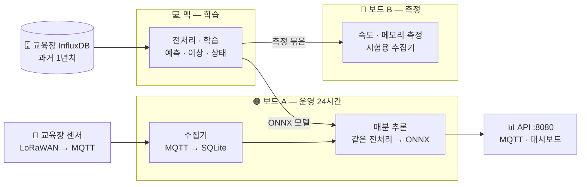

<div align="center">

# 🌿 교육장 공기, 매분 판단합니다

**교육장 CO₂ · 온도 · 습도 센서로 60분 뒤를 예측하고, 이상 · 사용 여부 · 환기 필요를 매분 알려 주는 Jetson 상시 추론 서비스**


[결과 한눈에](#-결과-한눈에) · [구조](#-구조) · [서비스](#-상시-추론-서비스-과제-8) · [시작하기](#-시작하기) · [과제별 실행](#-과제별-실행) · [보고서](#-보고서)

</div>

---

## ✨ 한 줄 요약

> 맥이 1년치 실데이터로 **학습**하고, 보드 A가 그 모델로 **매분 판단**해서 **API · MQTT · 대시보드**로 내보낸다.
> 모델과 임계값은 **검증 기간으로만** 골랐고, 시험 결과를 본 뒤 다시 고르지 않았다.

| 🌐 대시보드 | 📄 결과 형식 | 📊 제출 자료 |
|:---:|:---:|:---:|
| `http://100.113.228.46:8080` (Tailscale) | [docs/interface.md](docs/interface.md) | [final-presentation.pptx](docs/presentation/final-presentation.pptx) |

---

## 🏁 결과 한눈에

시험 기간 2026-09-23 ~ 10-21 (실데이터, 시간 순서 분할) · 보드 전력 모드 MAXN SUPER

| 과제 | 무엇을 | 핵심 결과 | 판정 |
|:---:|---|---|:---:|
| 1 | 데이터 수집 | 두 보드 모두 30/30 항목 커버율 95% 이상 (최저 **98.3%**), 재접속 15~18초, 재부팅 56초 뒤 재수집 | ✅ |
| 2 | 진단 · 기준선 | 가장 강한 기준선 = 현재값 유지 (60분 CO₂ **36.3 ppm**) | ✅ |
| 3 | 60분 예측 | GRU 31.3 ppm, 기준선보다 **13.8%** 감소 (목표 30%) · 온도 32.6% 감소 | ⚠️ CO₂ 미통과 |
| 4 | 이상 탐지 | 탐지율 **69%** (목표 80%) · 헛경보 하루 0회 | ⚠️ 탐지율 미통과 |
| 5 | 상태 추정 | 환기 선제 경보 재현율 **88.0%** · macro-F1 0.626 > 규칙 0.608 | ✅ |
| 6 | 사전학습 모델 | GRU 31.3 < Chronos-Bolt 32.4 ppm · Chronos 39~139 ms, +213 MB | ✅ |
| 7 | 엣지 최적화 | ONNX Runtime CPU **0.22 ms** (PyTorch의 46배), CO₂ 차이 0.25 ppm | ✅ |
| 8 | 상시 서비스 | 보드 A 12:14부터 무중단 가동 · API · MQTT · 결과 형식 문서 | 🔄 12시간 진행 중 |

<details>
<summary><b>💡 가장 의외였던 발견 — 검증에서 꼴찌였던 모델이 시험에서 1등이었다</b></summary>

<br>

| GRU 변형 (씨앗 3개 평균) | 검증 60분 CO₂ | 시험 60분 CO₂ |
|---|---:|---:|
| 센서 + 시간표 | 74.6 | 30.3 |
| 센서 + 시각 · 요일 ← 검증으로 선택 | **73.7** | 32.2 |
| 센서만 | 82.6 (꼴찌) | **30.0 (1등)** |

검증 기간(개강 직후)이 시험 기간(추석 연휴)보다 3배 더 출렁였다. 규칙대로 검증으로만 골라서 1등을 놓쳤다.
→ 기간 하나로 고르면 운에 맡기는 것. 다음에는 여러 기간으로 교차 검증하고, 서비스는 60분 전 예측을 실제값으로 스스로 채점한다.

</details>

---

## 🧭 구조



| 장비 | 역할 | 규칙 |
|---|---|---|
| 💻 맥 | 학습 전부, 하드웨어가 필요 없는 작업 | 맥이 켜져 있을 때만 학습 |
| 🟢 보드 A `team5-a` | 수집기 · 상시 추론 서비스 | 실험 · 재부팅 · 코드 수정 금지, `git pull`로만 배포 |
| 🧪 보드 B `team5-b` | Jetson 속도 · 메모리 측정, 시험용 수집기 | **학습 금지** (코드가 거부, `pipeline/guard.py`), 무거운 작업은 메모리 2GB 상한 |

> 학습과 서비스가 **같은 전처리 코드**(`pipeline/preprocess.py`)를 써서 학습 때 본 입력과 운영 입력이 어긋나지 않는다.

---

## 🛰️ 상시 추론 서비스 (과제 8)

매분: 수집 DB → 학습과 같은 전처리 → ONNX 예측 · 이상 점수 · 상태 판단 → 경보 → API · MQTT 발행

| 경로 | 내용 |
|---|---|
| `GET /` | 대시보드 (네 공간 2×2, 60분 예측 그래프) |
| `GET /health` | 서비스 상태, 주기 수, 실패 수, 모델 이름 |
| `GET /v1/spaces` | 모든 공간의 현재 판단 |
| `GET /v1/spaces/<slug>/forecast?minutes=60` | 5~60분 예측 |
| `GET /v1/spaces/<slug>/anomaly` · `/state` · `/alerts` | 이상 · 사용 여부 · 환기 · 경보 |
| `GET /v1/alerts` | 전체 경보 |
| MQTT `aip/team5/jaeung/inference/<slug>/state` | 공간 상태 (retained) · `alerts` · `status`(LWT) |

- **무중단 모델 교체** — 모델 파일만 바꾸면 다음 주기에 새 모델을 쓴다 (manifest 해시 감시).
- **끊김 경보** — 센서가 멈추면 `sensor_gap`, 수집기가 5분 넘게 조용하면 `data_gap`(`scope: collector`).
- **스스로 채점** — 60분 전에 낸 예측을 실제값과 비교해 오차가 커지면 `forecast_drift` 경보.

필드 · 단위 · 예시는 [docs/interface.md](docs/interface.md)에 있다.

---

## 🚀 시작하기

과제 안내 원문은 팀 Private 저장소 `AIP-1-5/docs`에 있다. 두 저장소를 나란히 clone한다.

> 교육장 네트워크는 밖으로 나가는 22번 포트를 막는다. 보드에서는 먼저 `~/.ssh/config`에 GitHub SSH를 443번으로 우회하는 설정을 넣는다(`../docs/environment.md`의 네트워크 항목).

```bash
mkdir -p ~/work && cd ~/work
git clone git@github.com:AIP-1-5/docs.git
git clone git@github.com:AIP-1-5/AIGJ_01_012_timeseries-inference.git
cd AIGJ_01_012_timeseries-inference
cp .env.example .env            # 값은 팀 단톡방에서 받는다 (커밋 금지)
claude --add-dir ../docs        # 과제 문서도 읽을 수 있게 Claude Code 실행

python3 -m venv .venv
.venv/bin/pip install -r requirements.txt -r requirements-dev.txt
.venv/bin/pytest -q             # 단위 시험
```

| 설치 파일 | 어디서 | 용도 |
|---|---|---|
| `requirements.txt` · `requirements-dev.txt` | 모두 | 수집기 · 시험 |
| `requirements-analysis.txt` | 맥 | 전처리 · 분석 (과제 2) |
| `requirements-train.txt` | 맥 | 학습 (과제 3~6) |
| `requirements-service.txt` | 보드 A | 상시 서비스 (ONNX Runtime, torch 없음) |

`./<이름>.sh <명령>`은 `.env`를 불러온 뒤 `.venv/bin/python -m <이름> <명령>`을 실행하는 줄임이다. 자주 쓰는 명령은 [docs/cheatsheet.md](docs/cheatsheet.md)에 상황별로 모았다.

---

## 🛠️ 과제별 실행

<details>
<summary><b>과제 1 · 수집기</b> — 보드 A · B</summary>

MQTT 센서 메시지를 받아 보드 안 SQLite(`data/collector.db`)에 저장한다. 설계 `specs/001-data-collection/`, 실행 · 시험 순서 [quickstart.md](specs/001-data-collection/quickstart.md).

```bash
./collector.sh check-config                 # 설정 점검
./collector.sh run                          # 앞에서 실행 (Ctrl+C로 종료)
sudo deploy/install-service.sh              # 서비스 collector-$USER 등록 (재부팅 후 자동 시작)

./collector.sh status                       # 지금 잘 쌓이고 있나 (끊긴 항목이 있으면 종료 코드 3)
./collector.sh report --hours 24            # docs/reports/001-collection-status.md
./collector.sh export --from 2026-10-21 --to 2026-10-22 --out data/export.csv
```

| 파일 | 역할 |
|---|---|
| `config/collector.toml` | 브로커, 토픽, 메시지 해석 규칙, 센서별 전송 간격 (형식이 바뀌면 여기만 고친다) |
| `collector/` | `parser.py` 해석 · `store.py` 저장 · `mqtt_client.py` 재접속 · `coverage.py` 커버율 · 결측 원인 · `report.py` 보고서 |

</details>

<details>
<summary><b>과제 2 · 데이터 진단 · 기준선</b> — 보드 B에서 내려받고 맥에서 분석</summary>

```bash
# 보드 B: InfluxDB는 보드 B 유선으로만 닿는다
./pipeline.sh export-influx --from 2025-08   # data/raw/influx/<항목>/<YYYY-MM>.csv.gz
./pipeline.sh check-time                     # InfluxDB 시각 vs 수집기 시각

# 맥
./pipeline.sh preprocess    # 정제 · 5분 칸 · 공간 중앙값 · 보간 · 고장 표시
./pipeline.sh split         # 기간 분할(artifacts/split.json), 정규화 값(학습 기간만)
./pipeline.sh diagnose      # 결측률 · 하루 패턴 · 일정 반응 → docs/reports/figures/002-*.png
./pipeline.sh baselines     # 평가 시점 고정(artifacts/eval_points.csv), 기준선 MAE
./pipeline.sh report        # docs/reports/002-diagnosis.md 초안
```

`config/preprocess.toml`과 `artifacts/`는 과제 3~8이 함께 쓰는 약속이라 커밋한다.

</details>

<details>
<summary><b>과제 3~6 · 예측 · 이상 탐지 · 상태 · 사전학습</b> — 맥</summary>

```bash
./forecast.sh samples && ./forecast.sh train && ./forecast.sh select   # 검증 기간으로만 선택
./forecast.sh evaluate --split test && ./forecast.sh compare && ./forecast.sh analyze

./anomaly.sh all            # train → calibrate(검증) → evaluate(시험 1회)
./state.sh run              # 사용 여부 · 환기 경보 학습 · 평가
./state.sh observe --db data/collector.db   # 직접 관찰 기록으로 채점
./pretrained.sh predict && ./pretrained.sh report
```

보드에서 학습 명령을 실행하면 `pipeline/guard.py`가 거부한다.

</details>

<details>
<summary><b>과제 7 · 엣지 최적화</b> — 맥에서 묶고 보드 B에서 측정</summary>

```bash
./edge.sh prepare                                        # 맥: 모델 + 시험 입력 2,000개 → data/edge/bundle/
scp -r data/edge/bundle board-b:~/work/AIGJ_01_012_timeseries-inference/data/edge/
free -h                                                  # 보드 B: 남은 메모리 확인
systemd-run --user --scope -p MemoryMax=2G env EDGE_PYTHON=.venv-gpu/bin/python ./edge.sh all
                                                         # 보드 B: 측정 → docs/reports/007-comparison.md
```

</details>

<details>
<summary><b>과제 8 · 상시 서비스</b> — 보드 A</summary>

```bash
./service.sh export                 # 학습 결과를 data/models/로 묶기 (ONNX 변환)
./service.sh once                   # 한 주기만 계산해 JSON 출력 (배포 확인)
./service.sh run                    # 매분 계산 + HTTP API + MQTT
./service.sh summary --hours 12 --score   # 주기 기록 → docs/reports/008-service-log.md
sudo deploy/install-inference.sh    # systemd 등록 (재부팅 후 자동 시작)
```

</details>

---

## 📚 보고서

| 과제 | 해석 보고서 | 자동 생성 표 · 기록 |
|:---:|---|---|
| 1 | [001-findings](docs/reports/001-findings.md) | [보드 A](docs/reports/001-collection-status.md) · [보드 B](docs/reports/001-collection-status-b.md) · [장애 시험](docs/reports/001-failure-tests.md) |
| 2 | [002-diagnosis](docs/reports/002-diagnosis.md) | [002-baselines](docs/reports/002-baselines.md) |
| 3 | [003-forecast](docs/reports/003-forecast.md) | [모델 비교](docs/reports/003-model-comparison.md) · [시험 기록](docs/reports/003-test-log.md) |
| 4 | [004-anomaly](docs/reports/004-anomaly.md) | [004-detection](docs/reports/004-detection.md) |
| 5 | [005-state](docs/reports/005-state.md) | [005-classification](docs/reports/005-classification.md) |
| 6 | [006-pretrained](docs/reports/006-pretrained.md) | [006-comparison](docs/reports/006-comparison.md) |
| 7 | [007-edge](docs/reports/007-edge.md) | [007-comparison](docs/reports/007-comparison.md) |
| 8 | [008-service](docs/reports/008-service.md) | [docs/interface.md](docs/interface.md) |
| 전체 | [000-final-report](docs/reports/000-final-report.md) | [제출 PPT](docs/presentation/final-presentation.pptx) |

---

## 📁 저장소 구성

```text
.
├── collector/   pipeline/                  과제 1 수집기 · 과제 2 전처리 · 분할 · 기준선 (공용)
├── forecast/    anomaly/    state/         과제 3 · 4 · 5 모델
├── pretrained/  edge/                      과제 6 사전학습 비교 · 과제 7 엣지 측정
├── service/                                과제 8 상시 추론 서비스 (+ dashboard.html)
├── config/      artifacts/                 설정 · 과제 간 공유 약속 (분할 · 정규화 · 평가 시점)
├── deploy/                                 systemd 서비스와 설치 스크립트
├── docs/        reports/ · presentation/   결과 보고서 · 제출 자료 · 결과 형식 문서
├── specs/                                  과제별 spec · plan · tasks (Spec Kit)
└── tests/                                  단위 시험
```

---

## 📏 지키는 규칙

- ⏱️ 학습 · 검증 · 시험은 **시간 순서**로 나눈다. 섞지 않는다.
- 📐 정규화 값은 **학습 기간**으로만 계산한다. 시험 기간은 학습 · 선택에 쓰지 않는다.
- ⚖️ 기준선과 모델은 **같은 평가 시점 · 같은 정답**으로 비교한다.
- 📝 모든 결과표에 **측정 조건**(데이터 기간, 실데이터 여부, 시험 기간, 전력 모드)과 **해석**(왜 · 그래서)을 붙인다.
- 🔒 비밀값은 `.env`에서만 읽는다. 데이터 · DB · `.pt` `.onnx` `.engine`은 커밋하지 않는다.

### Spec Kit으로 과제 진행

1. `/speckit-specify` — 과제 문서의 확인 기준을 spec의 완료 조건으로
2. `/speckit-plan` → `/speckit-tasks` — 계획과 할 일. 여기서 멈추고 검토
3. `/speckit-implement` — 구현
4. `/speckit-converge` — 확인 기준을 충족할 때까지 반복

작업 규칙과 장비 정보는 [CLAUDE.md](CLAUDE.md), 원칙은 [.specify/memory/constitution.md](.specify/memory/constitution.md).
