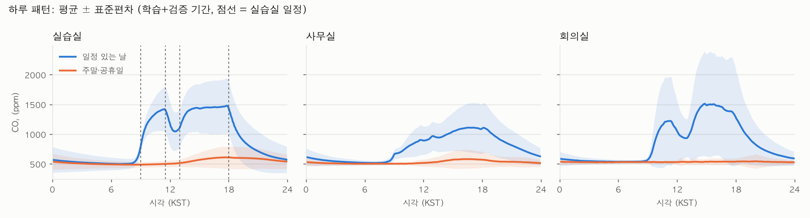
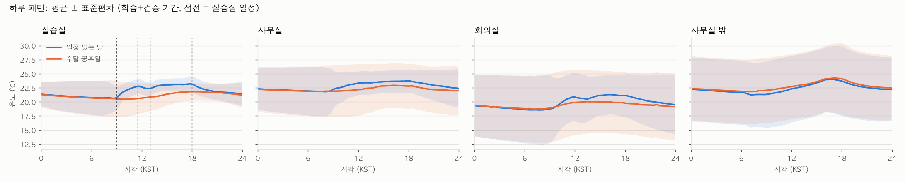
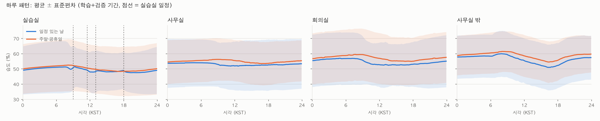
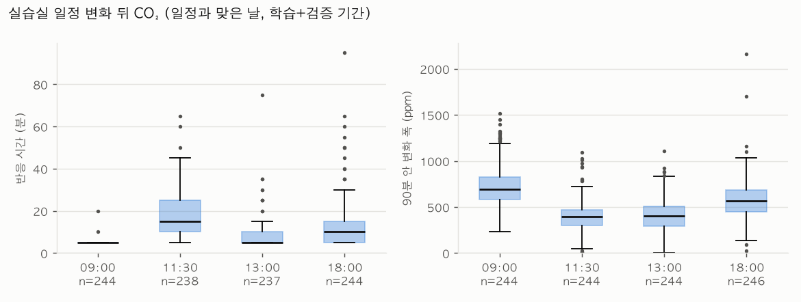
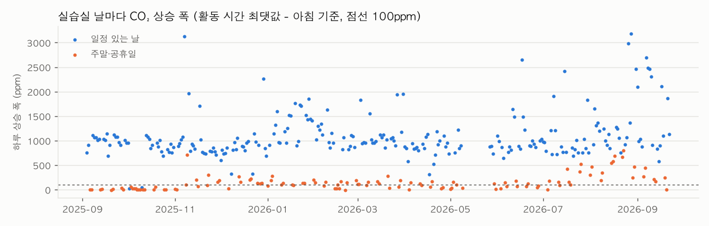

# 과제 2 진단서: 데이터 이해와 기준선

`python -m pipeline report`가 만든 초안이다. 숫자·표·그래프는 자동, ✍️ 칸은 직접 쓴다.

## 1. 측정 조건

| 항목 | 값 |
|---|---|
| 데이터 | 실데이터 (교육장 InfluxDB `iot-bucket`), 합성 아님 |
| 데이터 기간 | 2025-09-03 15:45 ~ 2026-10-21 16:00 KST (5분 칸 끝 시각) |
| 학습 기간 | 2025-09-03 ~ 2026-08-26 KST (끝 미포함, 357일) |
| 검증 기간 | 2026-08-26 ~ 2026-09-23 KST (끝 미포함, 28일) |
| 시험 기간 | 2026-09-23 ~ 2026-10-21 KST (끝 미포함, 28일) |
| 칸 | 5분, [t−5분, t) → t |
| 실행 환경 | Darwin arm64, Python 3.12.15 (분석은 보드 밖에서, 전력 모드 해당 없음) |
| 코드·설정 커밋 | `4587edc` (`preprocess.toml`) |
| 공간 | 실습실, 사무실, 회의실, 사무실 밖 |
| 일정 | 사용자 제공 추정 일정 (2026-10-21) (실습실만, 회의실·사무실은 일정이 유동적이라 제외) |
| 패턴·일정 분석 기간 | 학습+검증 (시험 기간은 보지 않는다) |

## 2. 정제 규칙과 이유

| 규칙 | 값 | 이유 |
|---|---|---|
| co2 허용 범위 | 300 ~ 5000 | 외기가 약 420ppm이라 300 밑은 불가능, 0은 깨진 값, 5,000 초과는 센서 범위 밖 |
| temperature 허용 범위 | 0 ~ 45 | 실내 공간, 60℃ 같은 값은 깨진 값 |
| humidity 허용 범위 | 1 ~ 99 | 0·100은 센서 오류값으로 자주 나온다 |
| 센서 ID 없는 행 | 뺀다 | 2025-08 초기 데이터는 `device_id` 태그가 없어 센서를 구분할 수 없다 |
| 중복 | 같은 센서가 10초 안에 다시 보낸 기록은 첫 번째만 | InfluxDB가 받은 순간 시각으로 저장해 두 번 도착한 메시지가 1초 미만 차이로 둘 다 남는다. 전송 간격은 최소 1분 |
| 칸 | 5분, [t−5분, t) → t | 과제 3이 5분 간격 예측. 시각 t에는 t 이전 값만 들어가 미래가 섞이지 않는다 |
| 공간 값 | 센서들의 중앙값 | 한 대가 고장 나도 크게 흔들리지 않는다 |
| 짧은 결측 | 15분 이하만 선형 보간 | 10분 센서의 메시지 1건 손실까지만 채운다 |
| 보간 값 | 입력에는 쓰되 정답으로는 안 쓴다 | 직선으로 채운 값을 맞히면 성적이 부푼다 |
| 값 고정 | 같은 값이 co2 6시간, temperature 24시간, humidity 24시간 이상 → 고장 의심 | 과제 4의 '값 고정' 고장. 학습·평가 정답에서 뺀다. 기준은 정상인 빈방의 가장 긴 정체(CO₂ 3.3시간, 온도·습도 약 15시간)보다 길게 잡았다. 60분이면 온도·습도 해상도 때문에 정상인 밤이 고장으로 잡힌다 |

## 3. 결측률과 제거 건수

| 공간 | 항목 | 센서 | 센서 ID 없음 | 범위 밖 제거 | 중복 | 관측 | 보간 | 결측 | 고장 의심 | 시험 기간 관측 |
|---|---|---:|---:|---:|---:|---:|---:|---:|---:|---:|
| 실습실 | co2 | 4 | 9,363 | 1,073 | 114,543 | 96.0% | 0.0% | 4.0% | 0.0% | 100.0% |
| 실습실 | temperature | 7 | 9,355 | 22 | 137,674 | 96.0% | 0.0% | 4.0% | 0.0% | 100.0% |
| 실습실 | humidity | 7 | 9,354 | 22 | 137,963 | 96.0% | 0.0% | 4.0% | 0.0% | 100.0% |
| 사무실 | co2 | 1 | 8,273 | 0 | 40,574 | 82.5% | 0.0% | 17.5% | 0.0% | 100.0% |
| 사무실 | temperature | 2 | 17,067 | 0 | 78,922 | 82.5% | 0.0% | 17.5% | 0.0% | 100.0% |
| 사무실 | humidity | 2 | 17,069 | 0 | 78,945 | 82.5% | 0.0% | 17.5% | 0.0% | 100.0% |
| 회의실 | co2 | 1 | 165 | 11 | 171 | 47.5% | 48.3% | 4.2% | 0.0% | 49.8% |
| 회의실 | temperature | 1 | 165 | 0 | 173 | 47.3% | 48.5% | 4.2% | 0.0% | 49.7% |
| 회의실 | humidity | 1 | 165 | 0 | 174 | 47.3% | 48.5% | 4.2% | 0.0% | 49.7% |
| 사무실 밖 | temperature | 1 | 8,574 | 368 | 70,271 | 78.0% | 0.0% | 22.0% | 0.0% | 100.0% |
| 사무실 밖 | humidity | 1 | 8,573 | 368 | 69,937 | 78.0% | 0.0% | 22.0% | 0.0% | 100.0% |

하루 넘게 이어진 빈칸:

- 실습실 co2: 2026-05-10 07:25 ~ 2026-05-26 16:45 (16.4일), 2025-12-07 08:00 ~ 2025-12-07 13:25 (0.2일), 2026-03-16 13:10 ~ 2026-03-16 14:40 (0.1일)
- 실습실 temperature: 2026-05-10 07:25 ~ 2026-05-26 16:45 (16.4일), 2025-12-07 08:00 ~ 2025-12-07 13:25 (0.2일), 2026-03-16 13:10 ~ 2026-03-16 14:40 (0.1일)
- 실습실 humidity: 2026-05-10 07:25 ~ 2026-05-26 16:45 (16.4일), 2025-12-07 08:00 ~ 2025-12-07 13:25 (0.2일), 2026-03-16 13:10 ~ 2026-03-16 14:40 (0.1일)
- 사무실 co2: 2026-01-23 03:10 ~ 2026-03-19 16:10 (55.5일), 2026-05-10 07:25 ~ 2026-05-26 16:45 (16.4일), 2025-12-07 08:00 ~ 2025-12-07 13:30 (0.2일)
- 사무실 temperature: 2026-01-23 03:10 ~ 2026-03-19 16:10 (55.5일), 2026-05-10 07:25 ~ 2026-05-26 16:45 (16.4일), 2025-12-07 08:00 ~ 2025-12-07 13:25 (0.2일)
- 사무실 humidity: 2026-01-23 03:10 ~ 2026-03-19 16:10 (55.5일), 2026-05-10 07:25 ~ 2026-05-26 16:45 (16.4일), 2025-12-07 08:00 ~ 2025-12-07 13:25 (0.2일)
- 회의실 co2: 2026-05-10 07:20 ~ 2026-05-26 16:45 (16.4일), 2025-12-07 07:55 ~ 2025-12-07 13:40 (0.2일), 2026-03-16 13:00 ~ 2026-03-16 14:55 (0.1일)
- 회의실 temperature: 2026-05-10 07:20 ~ 2026-05-26 16:45 (16.4일), 2025-12-07 07:55 ~ 2025-12-07 13:40 (0.2일), 2026-03-16 13:00 ~ 2026-03-16 14:55 (0.1일)
- 회의실 humidity: 2026-05-10 07:20 ~ 2026-05-26 16:45 (16.4일), 2025-12-07 07:55 ~ 2025-12-07 13:40 (0.2일), 2026-03-16 13:00 ~ 2026-03-16 14:55 (0.1일)
- 사무실 밖 temperature: 2026-01-08 11:40 ~ 2026-03-23 15:45 (74.2일), 2026-05-10 07:25 ~ 2026-05-26 16:45 (16.4일), 2025-12-07 08:00 ~ 2025-12-07 13:30 (0.2일)
- 사무실 밖 humidity: 2026-01-08 11:40 ~ 2026-03-23 15:45 (74.2일), 2026-05-10 07:25 ~ 2026-05-26 16:45 (16.4일), 2025-12-07 08:00 ~ 2025-12-07 13:30 (0.2일)

> ✍️ **해석 (직접 쓴다)**: 왜 이렇게 나왔고, 그래서 무엇을 해야 하는가.

## 4. 기간 분할

| 기간 | 시작 | 끝 (미포함) | 일수 |
|---|---|---|---:|
| 학습 | 2025-09-03 | 2026-08-26 | 357 |
| 검증 | 2026-08-26 | 2026-09-23 | 28 |
| 시험 | 2026-09-23 | 2026-10-21 | 28 |

정규화 값은 학습 기간 관측값으로만 계산했다 (`artifacts/normalization.json`, 기간 2025-09-03 ~ 2026-08-26).

**왜 무작위로 섞으면 안 되나**: 5분 칸은 이웃끼리 거의 같은 값이다. 무작위로 섞으면 시험 칸의 바로 앞뒤 칸이 학습에 들어가 모델이 '옆 칸 값을 외워서' 맞히게 되고, 시험 성적이 실제 운영보다 좋게 나온다. 또 미래 기간의 패턴(계절, 일정 변화)이 학습에 섞인다. 운영에서는 항상 과거로 미래를 예측하므로 평가도 시간 순서로 나눈다.

## 5. 하루 패턴

> ✍️ **해석 (직접 쓴다)**: 왜 이렇게 나왔고, 그래서 무엇을 해야 하는가.

## 6. 실습실 일정과 CO₂ 반응

### 실습실 (일정 있는 날 258일, 판정 367일)

일정과 맞은 날만 (사람 없던 일정일 제외):

| 일정 | 종류 | 측정한 날 | 반응한 날 | 반응 시간 중앙값 (25~75%) | 변화 폭 중앙값 (2시간 안) | 변화 폭 중앙값 (90분 안) |
|---|---|---:|---:|---|---:|---:|
| 09:00 오전 실습 시작 | 들어옴 | 244 | 244 | 5분 (5~5) | 744.4 ppm | 688.7 ppm |
| 11:30 점심 시작 (1~3명 남을 수 있음) | 일부 남음 | 244 | 238 | 15분 (10~25) | 395.4 ppm | 394.2 ppm |
| 13:00 오후 실습 시작 | 들어옴 | 244 | 237 | 5분 (5~10) | 442.3 ppm | 403.4 ppm |
| 18:00 퇴실 | 모두 나감 | 246 | 244 | 10분 (5~15) | 648.6 ppm | 566.4 ppm |

모든 일정일:

| 일정 | 종류 | 측정한 날 | 반응한 날 | 반응 시간 중앙값 (25~75%) | 변화 폭 중앙값 (2시간 안) | 변화 폭 중앙값 (90분 안) |
|---|---|---:|---:|---|---:|---:|
| 09:00 오전 실습 시작 | 들어옴 | 246 | 244 | 5분 (5~5) | 743.0 ppm | 688.4 ppm |
| 11:30 점심 시작 (1~3명 남을 수 있음) | 일부 남음 | 246 | 238 | 15분 (10~25) | 394.2 ppm | 393.6 ppm |
| 13:00 오후 실습 시작 | 들어옴 | 246 | 237 | 5분 (5~10) | 437.9 ppm | 401.9 ppm |
| 18:00 퇴실 | 모두 나감 | 248 | 244 | 10분 (5~15) | 645.9 ppm | 564.6 ppm |

달별 일정 일치:

| 달 | 일정 있는 날 | 사람 없던 날 | 주말·공휴일 | 일정 없이 쓴 날 | 일정일 상승 폭 중앙값 |
|---|---:|---:|---:|---:|---:|
| 2025-09 | 19 | 0 | 8 | 0 | 1013.2 ppm |
| 2025-10 | 18 | 2 | 13 | 0 | 873.9 ppm |
| 2025-11 | 20 | 0 | 10 | 6 | 870.5 ppm |
| 2025-12 | 22 | 0 | 9 | 7 | 845.7 ppm |
| 2026-01 | 21 | 0 | 10 | 7 | 1413.2 ppm |
| 2026-02 | 17 | 0 | 11 | 5 | 1070.2 ppm |
| 2026-03 | 21 | 0 | 10 | 7 | 1020.7 ppm |
| 2026-04 | 22 | 0 | 8 | 3 | 874.4 ppm |
| 2026-05 | 7 | 0 | 7 | 3 | 874.1 ppm |
| 2026-06 | 21 | 0 | 9 | 3 | 928.1 ppm |
| 2026-07 | 22 | 0 | 9 | 7 | 851.6 ppm |
| 2026-08 | 20 | 0 | 11 | 11 | 1216.1 ppm |
| 2026-09 | 16 | 0 | 6 | 5 | 1115.1 ppm |

어긋난 날 66일 (처음 20일): 2025-10-02(목) 사람 없음, 2025-10-10(금) 사람 없음, 2025-11-08(토) 일정 없이 씀, 2025-11-09(일) 일정 없이 씀, 2025-11-15(토) 일정 없이 씀, 2025-11-23(일) 일정 없이 씀, 2025-11-29(토) 일정 없이 씀, 2025-11-30(일) 일정 없이 씀, 2025-12-13(토) 일정 없이 씀, 2025-12-14(일) 일정 없이 씀, 2025-12-20(토) 일정 없이 씀, 2025-12-21(일) 일정 없이 씀, 2025-12-25(목) 일정 없이 씀, 2025-12-27(토) 일정 없이 씀, 2025-12-28(일) 일정 없이 씀, 2026-01-03(토) 일정 없이 씀, 2026-01-04(일) 일정 없이 씀, 2026-01-11(일) 일정 없이 씀, 2026-01-17(토) 일정 없이 씀, 2026-01-24(토) 일정 없이 씀

점심(11:30~13:00)에는 1~3명이 남을 수 있다(사용자 제보). 그래서 점심 감소 폭은 퇴실(18:00)보다 작고, 점심 동안 외기 수준(약 420ppm)까지 내려가지 않는 것이 정상일 수 있다.

> ✍️ **해석 (직접 쓴다)**: 왜 이렇게 나왔고, 그래서 무엇을 해야 하는가.

## 7. 고장 의심 구간과 처리

- 실습실 밤(02~05시) CO₂ 바닥값: 중앙값 482.6 ppm, 570 ppm 초과 39/397밤 (가장 길게 4밤 연속)
- 사무실 밤(02~05시) CO₂ 바닥값: 중앙값 500.2 ppm, 570 ppm 초과 30/342밤 (가장 길게 4밤 연속)
- 회의실 밤(02~05시) CO₂ 바닥값: 중앙값 514.0 ppm, 570 ppm 초과 31/397밤 (가장 길게 3밤 연속)

처리: 값 고정 구간은 학습과 평가 정답에서 뺀다(`fault=stuck`). 표시는 남겨 과제 4(이상 탐지)가 쓴다. 밤 바닥값 의심은 표시만 한다.

> ✍️ **해석 (직접 쓴다)**: 왜 이렇게 나왔고, 그래서 무엇을 해야 하는가.

## 8. 기준선

표 전체는 [002-baselines.md](002-baselines.md). 같은 평가 시점(`artifacts/eval_points.csv`)으로 과제 3·6 모델도 평가한다.

| 항목 | h | 가장 강한 기준선 | MAE |
|---|---:|---|---:|
| CO₂ | 5분 | 현재값 유지 | 7.28 ppm |
| CO₂ | 15분 | 현재값 유지 | 12.25 ppm |
| CO₂ | 30분 | 현재값 유지 | 21.99 ppm |
| CO₂ | 60분 | 현재값 유지 | 36.35 ppm |
| 온도 | 5분 | 현재값 유지 | 0.03 ℃ |
| 온도 | 15분 | 현재값 유지 | 0.05 ℃ |
| 온도 | 30분 | 현재값 유지 | 0.08 ℃ |
| 온도 | 60분 | 현재값 유지 | 0.15 ℃ |

> ✍️ **가장 강한 기준선과 그 이유 (완료 조건 3)**: 어느 기준선이 왜 강한지 숫자로 설명한다.

## 9. 자동 관찰 (숫자에서 뽑은 해석 재료)

- 사무실 co2 결측 17.5%: 긴 빈칸 목록에서 언제 끊겼는지 보고 원인(배터리, 설치 전, 게이트웨이)을 확인한다
- 사무실 temperature 결측 17.5%: 긴 빈칸 목록에서 언제 끊겼는지 보고 원인(배터리, 설치 전, 게이트웨이)을 확인한다
- 사무실 humidity 결측 17.5%: 긴 빈칸 목록에서 언제 끊겼는지 보고 원인(배터리, 설치 전, 게이트웨이)을 확인한다
- 회의실 co2 보간 48.3%: 10분 간격 센서라 칸 절반이 보간이다. 정답에서 빠져 평가 시점이 적다
- 회의실 temperature 보간 48.5%: 10분 간격 센서라 칸 절반이 보간이다. 정답에서 빠져 평가 시점이 적다
- 회의실 humidity 보간 48.5%: 10분 간격 센서라 칸 절반이 보간이다. 정답에서 빠져 평가 시점이 적다
- 사무실 밖 temperature 결측 22.0%: 긴 빈칸 목록에서 언제 끊겼는지 보고 원인(배터리, 설치 전, 게이트웨이)을 확인한다
- 사무실 밖 humidity 결측 22.0%: 긴 빈칸 목록에서 언제 끊겼는지 보고 원인(배터리, 설치 전, 게이트웨이)을 확인한다
- 실습실 CO₂: 일정 있는 날(평일) 하루 변동 980 ppm, 없는 날 124 ppm. 정점 17:50경 1479 ppm → 사람 수가 CO₂를 움직인다
- 사무실 CO₂: 일정 있는 날(평일) 하루 변동 595 ppm, 없는 날 80 ppm. 정점 16:30경 1110 ppm → 사람 수가 CO₂를 움직인다
- 회의실 CO₂: 일정 있는 날(평일) 하루 변동 977 ppm, 없는 날 17 ppm. 정점 14:50경 1512 ppm → 사람 수가 CO₂를 움직인다
- 실습실 90분 안 감소 폭: 점심 394.2 ppm vs 퇴실 566.4 ppm (비율 0.70) → 같은 시간 동안 점심이 덜 내려가면 남은 인원의 흔적
- 실습실: 일정이 있는데 CO₂가 거의 안 오른 날 2일 → 달별 표에서 몰린 달(방학, 과정 시작 전)을 찾는다
- CO₂ 5분 뒤: 가장 강한 기준선은 현재값 유지 (MAE 7.28 ppm)
- CO₂ 15분 뒤: 가장 강한 기준선은 현재값 유지 (MAE 12.25 ppm)
- CO₂ 30분 뒤: 가장 강한 기준선은 현재값 유지 (MAE 21.99 ppm)
- CO₂ 60분 뒤: 가장 강한 기준선은 현재값 유지 (MAE 36.35 ppm)
- 온도 5분 뒤: 가장 강한 기준선은 현재값 유지 (MAE 0.03 ℃)
- 온도 15분 뒤: 가장 강한 기준선은 현재값 유지 (MAE 0.05 ℃)
- 온도 30분 뒤: 가장 강한 기준선은 현재값 유지 (MAE 0.08 ℃)
- 온도 60분 뒤: 가장 강한 기준선은 현재값 유지 (MAE 0.15 ℃)

## 10. 생각해 볼 점

> ✍️ **'어제 같은 시각'이 약한/강한 이유와, 강할 만한 공간**:

> ✍️ **고장 구간을 학습·평가에 넣을지**:

> ✍️ **점심 1~3명 잔류가 패턴에 보이는지**:
