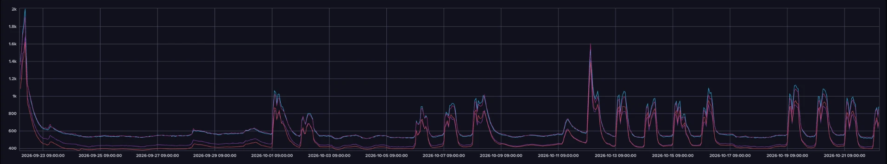

# 과제 3 60분 예측 보고서

숫자는 [003-model-comparison.md](003-model-comparison.md)(자동 생성), 시험 평가 순서는 [003-test-log.md](003-test-log.md)에 있다. 이 문서는 해석이다.

## 측정 조건

| 항목 | 값 |
| --- | --- |
| 데이터 | 실데이터(교육장 InfluxDB `iot-bucket`), 합성 아님. 2025-09-03 ~ 2026-10-21 KST |
| 분할 | 학습 2025-09-03 ~ 2026-08-26(357일), 검증 ~ 2026-09-23(28일), 시험 ~ 2026-10-21(28일). 시간 순서, 섞지 않음 |
| 평가 | 과제 2와 같은 평가 시점(`artifacts/eval_points.csv`)과 같은 정답(관측값), 원래 단위 |
| 모델 | GRU 2층·은닉 64(파라미터 약 6만), 과거 2시간 → 5~60분 12개 시점, 변화량 예측. 변형 3종 × 씨앗 3개 + 선형 + 값 직접 예측 = 11개 |
| 학습 장비 | 맥(Darwin arm64, mps), torch 2.14.1. 보드 전력 모드는 해당 없음 |
| 선택 | 검증 기간 점수로만 고름 → `gru-no_schedule-L120-s3`. 시험은 선택 기록 뒤에 한 번 |

## 완료 조건

| 조건 | 결과 | 판정 |
| --- | --- | --- |
| 1. 60분 CO₂가 현재값 유지보다 30% 이상 작다 | 31.33 vs 36.35 ppm (13.8% 감소, 목표 ≤ 25.44) | **미통과** |
| 2. 60분 온도가 현재값 유지보다 좋다 | 0.099 vs 0.146 ℃ (32.6% 감소) | **통과** |
| 3. 시험 데이터를 학습·선택에 쓰지 않았다 | 선택 시각 01:44:40Z → 시험 평가 01:44~01:45Z, 정규화도 학습 기간만 | **통과** |

시험 결과를 본 뒤 모델을 다시 고르지 않았다. 시험에서 가장 좋았던 실행(`gru-full-L120-s1-value`, 29.52 ppm, 18.8%)으로 바꿔도 30%에는 못 미친다.

## 무엇이 나왔나

| 구간 | 60분 CO₂ 모델 / 현재값 유지 | 해석 |
| --- | --- | --- |
| 전체 | 31.3 / 36.3 ppm (−14%) | 5·15·30분은 모두 이긴다(7.0/10.9/18.7 vs 7.3/12.3/22.0) |
| 사무실 | 29.5 / 38.3 (−23%) | 가장 잘 맞는다. 사람 수가 일정하고 변화가 완만하다 |
| 회의실 | 43.6 / 54.1 (−19%) | 오차 절대값은 가장 크다. 큰 오차 상위 50개 중 39개가 회의실 |
| 실습실 | 27.1 / 25.7 (**+5%**) | 60분에서는 기준선보다 못하다. 수업 중만 보면 64.3 / 61.0 |
| 수업 시작 직후 | 128.3 / 86.7 (+48%) | 가장 크게 진다 |
| 주말·공휴일 | 10.6 / 8.5 (+25%) | 바뀔 일이 없는 날에 변화를 예측한다 |

**원인 1: 시험 기간이 조용했다.**
- 현재값 유지의 60분 오차가 검증 기간에는 109.5 ppm, 시험 기간에는 36.4 ppm이다. 시험 기간에는 추석 연휴와 개천절·한글날이 끼어 있다.
- 시험 평가 시점의 34%(6,912개)가 주말·공휴일이고, 이때 현재값 유지 오차는 8.5 ppm이다.
- 바뀌지 않는 시간이 많으면 "그대로"가 거의 정답이다. 모델이 줄일 수 있는 오차는 소수의 큰 변화 순간에 몰려 있다.

*시험 기간 전체(2026-09-23 ~ 10-21)의 실습실·사무실·회의실 CO₂.* 교육장 InfluxDB Data Explorer 화면이며, 센서 6대의 1시간 평균이다.
- 9/23 ~ 9/30은 추석 연휴를 포함해 수업 패턴이 거의 없고, 400~600 ppm으로 평평하다.
- 평일마다 오르내리는 모양은 10/1부터 나온다.
- 시험 기간의 약 3분의 1이 "그대로 두면 맞는" 구간이다.

**원인 2: 검증 기간과 시험 기간의 순위가 뒤집혔다.**
- 센서만 쓰는 변형은 검증에서 꼴찌였다(82 ppm, 일정 정보를 넣은 변형은 73~75). 그런데 시험에서는 가장 좋았다(29.99).
- 고른 `no_schedule`은 검증 점수가 다른 변형과 0.001~0.004 차이였다. 그런데 시험의 실습실에서는 29.0 ppm으로 가장 나빴다(`full` 24.6, `sensor_only` 23.1).
- 28일짜리 검증 기간 하나는 시험 기간을 대표하지 못했다. 검증 기간(8월 말~9월)이 시험 기간보다 3배 더 출렁였다.

**원인 3: 실습실의 큰 변화는 센서에 미리 보이지 않는다.**
- 수업 시작, 쉬는 시간, 창문 개방처럼 사람이 정하는 순간에 CO₂가 꺾인다.
- 과거 2시간의 센서값에는 "몇 분 뒤 몇 명이 들어온다"는 정보가 없다. 그래서 모델은 평균적인 상승을 그리다가 시작 시점에 크게 틀린다.

## 다음에 할 일

1. **검증을 한 기간이 아니라 여러 계절로 나눠 고른다.** 예를 들어 학습 기간 안에서 28일짜리 여러 구간으로 시간 순서 교차 검증을 한다. 이번 같은 순위 뒤집힘을 줄이는 가장 직접적인 방법이다.
2. **센서 밖의 정보를 넣는다.**
   - 문 열림 센서(WS301, 사무실에 실제로 있음)
   - 냉난방 장비 상태(MQTT `xflow/...`)
   - 회의실 예약표, 수업 출석 인원
   - 원인 3을 줄일 수 있는 유일한 길이다.
3. **운영에서는 강한 구간만 쓴다.**
   - 5~30분 예측과 사무실·회의실 60분은 모델을 쓴다.
   - 실습실 60분은 현재값 유지와 비교한 자체 채점(과제 8 `monitor`)을 보고 정한다.
   - 서비스는 이미 60분 전 예측을 실제값으로 채점하고 있다.
4. **씨앗 평균(앙상블)을 기본으로 한다.** 씨앗 사이의 차이(같은 변형에서 최대 1.8 ppm)가 변형 사이의 차이만큼 크다. 그래서 실행 하나보다 평균이 안정적이다.

## 2차 선택 (2026-10-22 밤): 씨앗 평균과 섞기, 새 시험 기간

1차 시험 결과를 본 뒤 같은 기간에서 다시 고르면 시험 기간을 선택에 쓴 것이 된다. 그래서 2차는 이렇게 했다.

1. **시험 기간을 새로 정했다(사용자 결정, 10-22).** 2026-10-22 ~ 11-04 KST(14일). 이 기간은 학습·선택에 쓰지 않고, 11-05 이후에 한 번만 잰다.
2. **검증 기간으로만 골랐다(`python -m forecast ensemble`, 새 학습 없음).** 이미 학습한 실행 11개로 후보를 만들었다. 실행 하나, 같은 변형의 씨앗 평균, GRU 9개 평균, 그리고 평균과 값 직접 예측을 시점별로 섞은 것이다.

| 후보 (검증 기간) | 점수 | 60분 CO₂ | 현재값 유지 | 감소 |
| --- | ---: | ---: | ---: | ---: |
| 1차 선택 `gru-no_schedule-L120-s3` | 0.713 | 73.41 | 109.53 | −33.0% |
| **2차 선택** GRU 9개 평균 + 값 직접 예측 섞기 | **0.691** | **71.42** | 109.53 | **−34.8%** |

- 선택 기록: `data/forecast/ensemble_selection.json`(선택 시각 2026-10-22T09:08:11Z, 2차 시험 기간 함께 기록).
- 섞기에서 값 직접 예측의 비중은 작아서, 사실상 GRU 9개 평균과 같다.
- **판정은 아직이다.** 30% 기준은 2차 시험(11-05 이후)으로 판정한다. 1차 시험의 −13.8%는 그대로 남긴다.
- **서비스에 넣으려면:** 보드에서 모델 1개 대신 9개를 돌린다. ONNX 한 번이 0.22 ms라 9개도 2 ms 안쪽일 것으로 보지만, 보드 B에서 지연·메모리를 잰 뒤에 보드 A에 넣는다.

## 생각해 볼 점

**회의실이 어려운 이유와 없는 정보**
- 회의는 시간표가 없다. 작은 방이라 몇 명만 들어와도 CO₂가 수백 ppm 오른다.
- 센서가 10분 간격이라 5·15분 뒤 정답은 대부분 보간 칸이다. 그래서 평가 시점이 18개뿐이다.
- 없는 정보: 회의 예약(시작·끝 시각, 인원), 문 열림, 환기 장치 상태. 예약 시스템, WS301, `xflow` 토픽에서 얻을 수 있다.

**값 직접 예측과 변화량 예측**
- 변화량 모델은 출력이 0에서 시작하므로 처음부터 "현재값 유지"와 같고, 짧은 시점에 강하다. 5분 7.01 ppm으로 현재값 유지(7.28)보다 좋다.
- 값 직접 모델은 수준부터 다시 맞혀야 해서 5분 오차가 8.58로 기준선보다 나쁘다. 대신 60분에서는 평균으로 돌아가는 경향을 더 잘 잡아 29.52로 가장 좋았다.
- 검증 점수(0.811)는 나빴다. 짧은 시점은 변화량, 긴 시점은 값 직접 예측이 유리하다는 뜻이다. 두 방식을 시점별로 섞는 것이 다음 실험 후보다.

**오차가 가장 큰 순간과 맞힐 수 있는지**
- 수업 시작(+48%)과 점심(+11%)이다. 시간표를 넣은 `full` 변형은 실습실 60분 오차를 29.0 → 24.6 ppm으로 줄였다. 언제쯤 오를지는 일정으로 일부 맞힐 수 있다는 뜻이다.
- 정확히 몇 분에 몇 명이 들어오는지, 누가 창문을 여는지는 센서로 맞힐 수 없다. 현실적인 목표는 "오르기 시작한 뒤 15분 안에 따라잡기"와 "1,000 ppm 초과를 미리 경보하기"다. 환기 경보는 과제 5에서 재현율 88%로 따로 해결했다.
