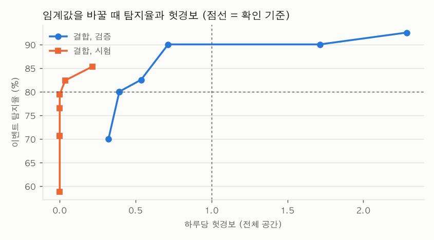

# 과제 4 탐지 성적표

`python -m anomaly evaluate`가 만든 표. 만든 시각 2026-10-22 09:01 UTC. 해석은 [004-anomaly.md](004-anomaly.md).

## 측정 조건

| 항목 | 값 |
|---|---|
| 데이터 | 실데이터 (교육장 InfluxDB `iot-bucket`), 합성 아님 |
| 데이터 기간 | 2025-09-03 15:45 ~ 2026-10-21 16:00 KST (5분 칸 끝 시각) |
| 학습 기간 | 2025-09-03 ~ 2026-08-26 KST (끝 미포함, 357일) |
| 검증 기간 | 2026-08-26 ~ 2026-09-23 KST (끝 미포함, 28일) |
| 시험 기간 | 2026-09-23 ~ 2026-10-21 KST (끝 미포함, 28일) |
| 칸 | 5분, [t−5분, t) → t |
| 실행 환경 | Darwin arm64, Python 3.12.15 (분석은 보드 밖에서, 전력 모드 해당 없음) |
| 코드·설정 커밋 | `1826f6f` (`preprocess.toml`) |
| 고장 | 합성 5종을 실데이터 복사본에 주입. 검증 씨앗 11 40건(임계값 결정), 시험 씨앗 33 34건(평가) |
| 모델 | 오토인코더 (창 12칸, 학습 기간 정상 데이터만), 임계값 0.0917 (2026-10-22T09:01:03Z, 검증 기준) |
| 규칙 기준값 | 학습 기간. 값 고정 칸 수 {'co2': 9, 'humidity': 230} (정상 최장 {'co2': 6, 'humidity': 153}) |
| 경보 묶기 | 60분 안의 경보는 한 이벤트, 고장 끝 뒤 유예 60분 |

## 완료 조건

| 조건 | 결과 | 판정 |
|---|---|---|
| 1. 모델+규칙 이벤트 탐지율 ≥ 80% | 27/34 = 79% | 미통과 |
| 2. 헛경보 ≤ 하루 1회 (전체 공간) | 0건 / 28일 = 0.00회/일 | 통과 |
| 3. 모델·규칙이 못 잡는 종류와 이유 | 아래 종류별 표, 해석은 004-anomaly.md | - |

## 고장 종류별 (시험 기간)

| 고장 | 건수 | 모델 | 규칙 | 결합 | 결합 지연 중앙값 | 원인 항목 맞음 (결합) |
|---|---:|---:|---:|---:|---:|---:|
| 튄 값 | 8 | 8/8 | 7/8 | 8/8 | 0분 | 7/8 |
| 값 고정 | 8 | 1/8 | 4/8 | 4/8 | 35분 | 4/8 |
| 영점 틀어짐 | 8 | 6/8 | 4/8 | 7/8 | 1190분 | 7/8 |
| 냉방 정지 | 8 | 8/8 | 4/8 | 8/8 | 138분 | 7/8 |
| 환기 정지 | 2 | 0/2 | 0/2 | 0/2 | - | 0/2 |

| 방법 | 탐지 | 탐지율 | 지연 중앙값 | 헛경보 | 하루당 |
|---|---:|---:|---:|---:|---:|
| 모델만 | 23/34 | 68% | 145분 | 0 | 0.00 |
| 규칙만 | 19/34 | 56% | 35분 | 0 | 0.00 |
| 결합 | 27/34 | 79% | 120분 | 0 | 0.00 |

헛경보를 낸 탐지기 (결합): 없음

## 임계값을 바꿀 때

| 임계값 | 검증 결합 탐지율 | 검증 헛경보/일 | 시험 결합 탐지율 | 시험 헛경보/일 | 시험 모델만 탐지율 |
|---:|---:|---:|---:|---:|---:|
| 0.0599 | 92% | 2.29 | 85% | 0.21 | 76% |
| 0.0705 | 90% | 1.71 | 82% | 0.04 | 74% |
| 0.0917 ← 선택 | 90% | 0.71 | 79% | 0.00 | 68% |
| 0.1084 | 82% | 0.54 | 79% | 0.00 | 65% |
| 0.1342 | 80% | 0.39 | 76% | 0.00 | 59% |
| 0.1709 | 80% | 0.39 | 71% | 0.00 | 47% |
| 0.1941 | 80% | 0.39 | 71% | 0.00 | 47% |
| 0.2972 | 70% | 0.32 | 59% | 0.00 | 26% |

## 놓친 고장 (결합)

| 종류 | 공간 | 항목 | 시작 (KST) | 크기 |
|---|---|---|---|---:|
| 값 고정 | 회의실 | humidity | 09-30 12:30 | 3.5 |
| 값 고정 | 사무실 밖 | temperature | 09-30 19:45 | 1.8 |
| 영점 틀어짐 | 실습실 | co2 | 10-05 05:15 | 289.8 |
| 값 고정 | 실습실 | humidity | 10-07 07:35 | 3.1 |
| 값 고정 | 회의실 | humidity | 10-07 23:30 | 2.9 |
| 환기 정지 | 실습실 | co2 | 10-14 13:00 | 1.8 |
| 환기 정지 | 실습실 | co2 | 10-19 13:00 | 1.8 |
