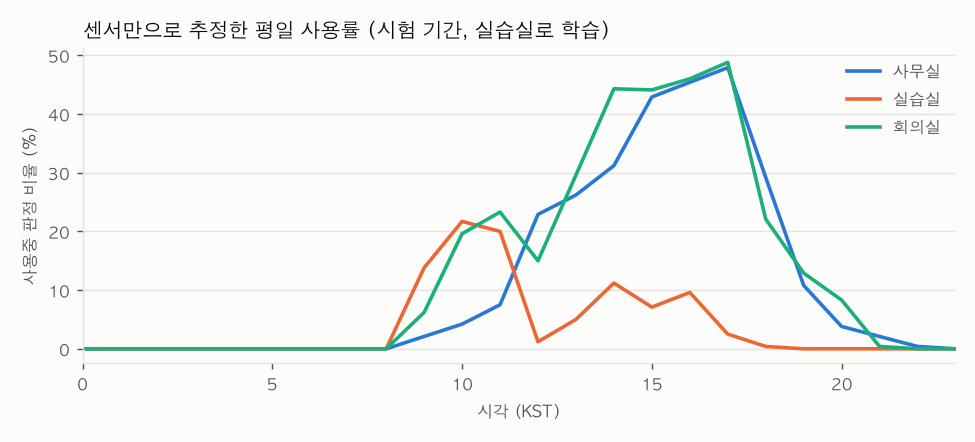

# 과제 5 분류 성적표

`python -m state run`이 만든 표. 만든 시각 2026-10-22 09:07 UTC. 해석은 [005-state.md](005-state.md).

## 측정 조건

| 항목 | 값 |
|---|---|
| 데이터 | 실데이터 (교육장 InfluxDB `iot-bucket`), 합성 아님 |
| 데이터 기간 | 2025-09-03 15:45 ~ 2026-10-21 16:00 KST (5분 칸 끝 시각) |
| 학습 기간 | 2025-09-03 ~ 2026-08-26 KST (끝 미포함, 357일) |
| 검증 기간 | 2026-08-26 ~ 2026-09-23 KST (끝 미포함, 28일) |
| 시험 기간 | 2026-09-23 ~ 2026-10-21 KST (끝 미포함, 28일) |
| 칸 | 5분, [t−5분, t) → t |
| 실행 환경 | Darwin arm64, Python 3.12.15 (분석은 보드 밖에서, 전력 모드 해당 없음) |
| 코드·설정 커밋 | `1826f6f` (`preprocess.toml`) |
| 사용 여부 정답 | 실습실 일정(평일 09:00~11:30·13:00~18:00, 공휴일 제외). 점심·일정 변화 직후 15분은 제외 |
| 사용 여부 입력 | 센서만 (CO₂·온도·습도 수준과 변화). 시각·요일·일정 없음 |
| 환기 경보 정답 | 지금 < 1,000 ppm이고 30분 안 ≥ 1,000 ppm. 이미 1,000 이상인 시각 제외 |
| 모델 | HistGradientBoosting(균형 가중치). 임계값은 검증 기간 (사용 여부 0.95: 비어있음→사용중 ≤ 2% 중 재현율 최대, 환기 0.54: 재현율 ≥ 85% 중 macro-F1 최대) |
| 직접 관찰 | 3구간 |

## 완료 조건

| 조건 | 결과 | 판정 |
|---|---|---|
| 1. 사용 여부: 관찰 시간대 정확도·F1, 비어있음→사용중 오류율, 규칙보다 좋음 | 관찰 기록 없음 → 시험 기간 일정 기준: F1 0.256 (규칙 0.270), 비어있음→사용중 0.0% | 규칙보다 못함 (관찰 기록 필요) |
| 2. 환기 경보 재현율 ≥ 85%, macro-F1 > 규칙 | 재현율 88.0%, macro-F1 0.626 (규칙 0.608) | 통과 |
| 3. 혼동 행렬과 가장 많이 헷갈리는 경우 | 아래 표, 해석은 005-state.md | - |

## 사용 여부 (실습실, 시험 기간, 일정 기준 정답)

| 방법 | 표본 | 정확도 | 정밀도 | 재현율 | F1 | macro-F1 | 비어있음→사용중 |
|---|---:|---:|---:|---:|---:|---:|---:|
| 모델 | 7,632 | 85.0% | 100.0% | 14.7% | 0.256 | 0.586 | 0.0% |
| 규칙: 15분 CO₂ +30 ppm 이상 | 7,632 | 84.9% | 89.5% | 15.9% | 0.270 | 0.593 | 0.4% |

모델 혼동 행렬:

| | 예측 0 | 예측 1 |
|---|---:|---:|
| 실제 0 | 6,288 | 0 |
| 실제 1 | 1,147 | 197 |

시각별 오류 (모델, 시험 기간): 비어있음→사용중(FP) / 사용중→비어있음(FN)

| 시각 | FP | FN |
|---:|---:|---:|
| 09시 | 0 | 111 |
| 10시 | 0 | 140 |
| 11시 | 0 | 69 |
| 13시 | 0 | 132 |
| 14시 | 0 | 165 |
| 15시 | 0 | 175 |
| 16시 | 0 | 169 |
| 17시 | 0 | 186 |

## 환기 선제 경보 (CO₂ 공간 3곳, 시험 기간)

양성 비율 1.1% — 늘 '아니오'라고만 해도 정확도가 98.9%다. 그래서 정확도 대신 재현율·macro-F1로 본다.

| 방법 | 표본 | 정확도 | 정밀도 | 재현율 | F1 | macro-F1 | 비어있음→사용중 |
|---|---:|---:|---:|---:|---:|---:|---:|
| 모델 | 22,525 | 94.9% | 16.5% | 88.0% | 0.277 | 0.626 | 5.0% |
| 규칙: 현재 CO₂ ≥ 850 ppm | 22,525 | 94.2% | 14.4% | 85.2% | 0.247 | 0.608 | 5.7% |

모델 혼동 행렬:

| | 예측 0 | 예측 1 |
|---|---:|---:|
| 실제 0 | 21,159 | 1,116 |
| 실제 1 | 30 | 220 |

| 공간 | 모델 재현율 | 모델 macro-F1 | 규칙 재현율 | 규칙 macro-F1 | 양성 수 |
|---|---:|---:|---:|---:|---:|
| 사무실 | 97.0% | 0.671 | 95.0% | 0.642 | 100 |
| 실습실 | 100.0% | 0.532 | 92.9% | 0.534 | 28 |
| 회의실 | 77.9% | 0.686 | 75.4% | 0.640 | 122 |

놓친 경보 예 (모델):

| 공간 | 시각 | CO₂ | 15분 변화 |
|---|---|---:|---:|
| 사무실 | 09-28(Mon) 15:20 | 889 | 10.0 |
| 사무실 | 10-08(Thu) 12:05 | 829 | 27.0 |
| 사무실 | 10-20(Tue) 16:50 | 833 | -41.0 |
| 회의실 | 09-28(Mon) 18:40 | 985 | -53.0 |
| 회의실 | 10-01(Thu) 14:00 | 834 | -18.0 |
| 회의실 | 10-01(Thu) 14:05 | 822 | -44.0 |
| 회의실 | 10-01(Thu) 14:10 | 810 | -40.0 |
| 회의실 | 10-02(Fri) 13:00 | 725 | -19.0 |
| 회의실 | 10-02(Fri) 13:05 | 702 | -70.0 |
| 회의실 | 10-02(Fri) 13:10 | 678 | -70.0 |
| 회의실 | 10-02(Fri) 13:15 | 712 | -12.0 |
| 회의실 | 10-02(Fri) 13:20 | 747 | 46.0 |
| 회의실 | 10-06(Tue) 09:30 | 601 | 65.0 |
| 회의실 | 10-06(Tue) 18:10 | 894 | -4.0 |
| 회의실 | 10-06(Tue) 18:25 | 898 | 4.0 |
