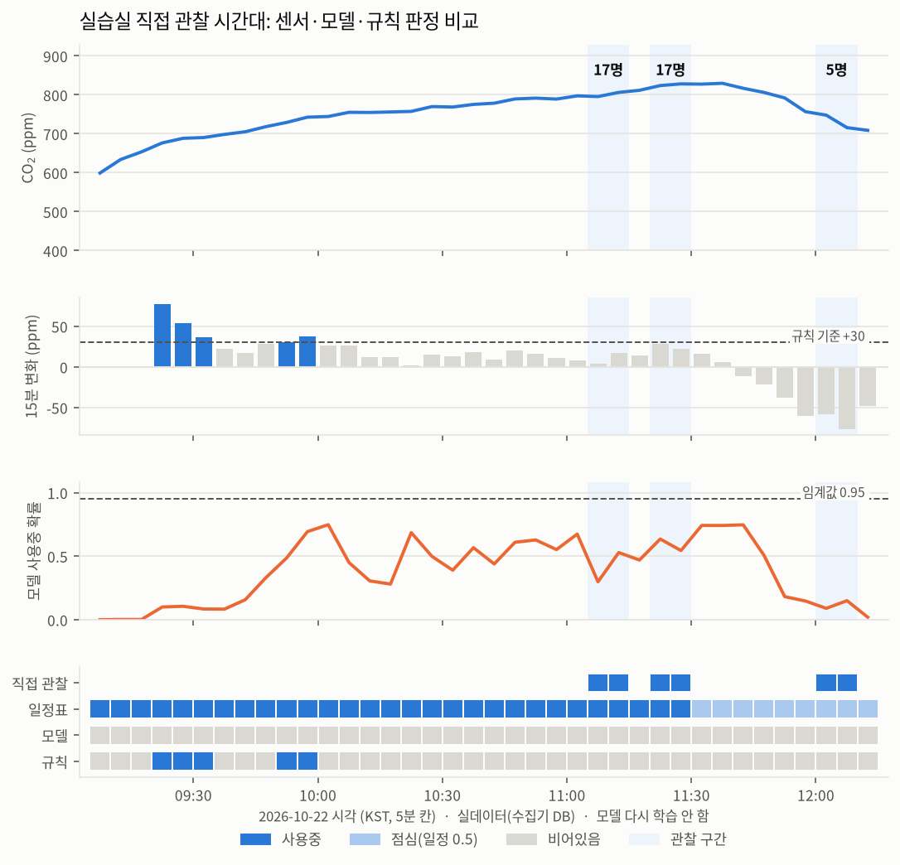

# 과제 5 상태 추정 보고서

숫자는 [005-classification.md](005-classification.md)(시험 기간, 자동 생성)와 [005-observation.md](005-observation.md)(직접 관찰, 자동 생성)에 있다. 이 문서는 해석이다.

## 측정 조건

| 항목 | 값 |
| --- | --- |
| 데이터 | 실데이터(교육장 InfluxDB). 학습 2025-09-03 ~ 2026-08-26, 검증 ~ 2026-09-23, 시험 ~ 2026-10-21 |
| 사용 여부 | 정답은 실습실 일정(평일 수업 시간, 공휴일 제외, 점심·전환 15분 제외)이다. 입력은 센서만(CO₂·온도·습도 수준과 변화)이다. 일정으로 정답을 만들었으므로 시각·일정은 입력에서 뺐다 |
| 환기 경보 | 지금 1,000 ppm 미만이고 30분 안에 1,000 이상이면 양성. 이미 넘은 시각은 제외. 입력은 센서 + 달력·일정 |
| 모델 | HistGradientBoosting(균형 가중치). 임계값은 검증 기간으로 정함(사용 여부: F1 최대 0.95, 환기: 재현율 ≥ 85% 중 macro-F1 최대 0.54) |
| 직접 관찰 | 2026-10-22 실습실 사람 수 기록 3구간(`docs/observations/occupancy.csv`, 5분 칸 6개). 채점은 그 시간 보드 B 수집기 DB(보드 A와 같은 MQTT 실시간 값)로, 보드 A 서비스와 같은 모델(`data/models-final/state.pkl`, 임계값 0.95)로 했다. 다시 학습하지 않음 |
| 장비 | 맥(Darwin arm64)에서 학습·평가. 보드 A 서비스가 같은 모델로 매분 판정 |

## 완료 조건

| 조건 | 결과 | 판정 |
| --- | --- | --- |
| 1. 사용 여부: 관찰 시간대 정확도·F1, 비어있음→사용중 오류율, 규칙보다 좋음 | 시험 기간(일정 기준): F1 0.256(규칙 0.270), 비어있음→사용중 **0.0%**(규칙 0.4%). 직접 관찰 6칸: 모델 정확도 **0.0%**, F1 0.000, 규칙도 0.0%, 오류율은 비어있음 관찰이 없어 계산 불가 ([005-observation.md](005-observation.md)) | **미통과**. 규칙보다 좋지 않고(둘 다 0), 비어있음 관찰이 없어 오류율을 못 냄 |
| 2. 환기 경보 재현율 ≥ 85%, macro-F1 > 규칙 | 재현율 **88.0%**, macro-F1 **0.626**(규칙 0.608) | **통과** |
| 3. 혼동 행렬과 가장 많이 헷갈리는 경우 | 아래 | **설명함** |

## 사용 여부: 신중하지만 놓친다

| | 예측 비어있음 | 예측 사용중 |
| --- | ---: | ---: |
| 실제 비어있음 | 6,288 | **0** |
| 실제 사용중 | **1,147** | 197 |

- **헷갈리는 경우는 거의 한쪽뿐이다.** "사람이 있는데 비었다"고 판단한 경우가 1,147칸이다. 모든 수업 시간대(09~17시)에 고르게 나온다.
- 반대로 "비었는데 사람이 있다"는 0칸이다. 냉난방 자동 제어에서 가장 비싼 오류(빈 방을 냉난방)는 한 번도 내지 않았다.
- **원인 1: 임계값이 극단적으로 높다(0.95).** 검증 기간에서 F1이 가장 높은 값을 골랐는데, 그 결과 확신이 아주 클 때만 "사용중"이라고 한다. 검증 기간(개강 직후)과 시험 기간(연휴가 많음)의 분포가 달라 과제 3·4와 같은 문제가 반복됐다.
- **원인 2: 정답(일정)이 실제와 다를 수 있다.** 일정상 수업 시간이라도 실제로 비어 있거나 인원이 적은 날이 있다. 프로젝트 준비 기간, 외부 일정 등이다. 이런 칸은 센서가 맞고 정답이 틀린 것이다. 직접 관찰을 받는 이유가 이것이다.
- **원인 3: 사람이 꾸준히 있으면 CO₂가 오르다 평평해진다.** 변화량 특성만 보면 평평한 사용중과 빈 방이 비슷해 보인다.

**다음에 할 일**
- 임계값을 "F1 최대" 대신 **"비어있음→사용중 ≤ 2%를 지키면서 재현율 최대"**로 정한다. 제어 목적(빈 방 냉난방 금지)을 기준에 직접 넣는 것이다.
- 정답을 일정 대신 **문 열림 센서(WS301)와 소음 센서(WS302)**로 보강한다. 둘 다 교육장에 실제로 설치되어 있다.

## 환기 경보: 놓치지 않지만 자주 울린다

- 재현율 88%로 기준을 넘었다. 사무실 97%, 실습실 100%다.
- **회의실은 77.9%**다. 놓친 예는 대부분 CO₂가 내려가던 중(15분 변화 −40~−70 ppm)이다. 회의가 잠깐 쉬었다가 다시 시작하는 경우로, 미리 알 수 없다.
- **정밀도는 16.5%다.** 28일 동안 3개 공간에서 헛경보가 1,116칸이다. 칸 기준으로는 하루 40칸이다.
- 그대로 사람에게 보내면 경보를 무시하게 된다. 그래서 과제 8 서비스는 같은 경보를 30분에 한 번만 보낸다. 사람이 받는 횟수는 이보다 훨씬 적다.
- 양성 비율이 1.1%뿐이라 "항상 아니오"라고 해도 정확도가 98.9%다. 그래서 정확도 대신 재현율과 macro-F1로 판정했다.

## 생각해 볼 점

**막 나간 직후의 빈 방은 왜 '사용중'으로, 막 들어온 직후는 왜 '비어있음'으로 오판되나?**
- CO₂는 사람이 나가도 환기로 천천히(수십 분) 빠지고, 들어와도 천천히 쌓인다.
- 센서값이 사람의 출입보다 늦게 따라온다. 나간 직후에는 아직 높아서 "사용중", 들어온 직후에는 아직 낮아서 "비어있음"으로 보인다.
- 이 지연은 방의 크기와 환기량이 정하는 물리 현상이다. 모델로 없앨 수 없다. 그래서 시험 평가에서 전환 직후 15분을 뺐다.
- 줄이려면 문 열림이나 소음처럼 즉시 반응하는 센서가 필요하다.

**적은 인원이 쓰는 큰 강의실은 센서로 구별할 수 있나?**
- 어렵다. 같은 3명이라도 큰 방에서는 CO₂ 상승이 작고 느려 센서 잡음 안에 묻힌다.
- 방이 클수록 신호는 작아지고 늦어진다. 방마다 기준을 따로 잡거나(부피로 나눈 상승 속도), 소음·문 열림 같은 다른 신호를 써야 한다.
- 이번 모델을 실습실로만 학습한 것도 이 때문이다. 다른 방에 그대로 쓰면 기준이 맞지 않는다.

**환기 경보의 정밀도가 낮으면 현장에서 무슨 일이 생기나? 무엇을 우선하나?**
- 헛경보가 많으면 사람들이 경보를 끄거나 무시한다. 그러면 진짜 경보도 묻힌다.
- 그래도 건강과 관련된 경보라 **재현율을 우선**하고, 정밀도 문제는 보내는 방식으로 줄인다.
  - 같은 경보는 30분에 한 번만 보낸다.
  - 여러 주기 연속일 때만 띄운다.
  - "주의 / 환기 필요" 두 단계로 나눈다.

**과제 3 예측 모델로도 판단할 수 있는데 분류기를 따로 두는 게 나은가?**
- 예측 모델은 평균 오차(MAE)를 줄이도록 학습했다. 그래서 1,000 ppm을 넘는 드문 순간을 맞히는 데 최적화되어 있지 않다. 분류기는 그 결정 자체를 학습하고, 재현율 목표로 임계값을 맞출 수 있다.
- 대신 예측 모델은 "몇 분 뒤"라는 시간 정보를 준다.
- 과제 8 서비스는 둘 다 쓴다: `co2_forecast`("45분 뒤 초과 예상")와 `ventilation`("30분 안 환기 필요"). 운영 기록에서 어느 쪽이 먼저, 더 정확하게 울렸는지 비교하는 것이 다음 단계다.

## 직접 관찰 결과: 사람이 있는데 6칸 모두 "비었다"

숫자는 [005-observation.md](005-observation.md)(자동 생성). 2026-10-22 오전, 실습실을 직접 보고 적은 3구간(17명, 17명, 5명)이다.



| 구간 (KST) | 관찰 인원 | CO₂ | 15분 변화 | 모델 확률 (임계값 0.95) | 모델 | 규칙 (+30 ppm) |
| --- | ---: | ---: | ---: | ---: | --- | --- |
| 11:05 ~ 11:15 | 17 | 796 ~ 806 | +4 ~ +17 | 0.30 ~ 0.53 | 비어있음 ✗ | 비어있음 ✗ |
| 11:20 ~ 11:30 | 17 | 824 ~ 828 | +22 ~ +28 | 0.54 ~ 0.64 | 비어있음 ✗ | 비어있음 ✗ |
| 12:00 ~ 12:10 | 5 | 716 ~ 748 | −58 ~ −76 | 0.09 ~ 0.15 | 비어있음 ✗ | 비어있음 ✗ |

모델 정확도 0.0%, F1 0.000. 규칙도 0.0%, F1 0.000. 일정표는 수업 시간 4칸을 모두 맞혔다(점심 2칸은 일정에서 판단 안 함).

**시간대가 어긋난 것은 아니다.** 결과가 0%라서 KST/UTC 맞춤부터 확인했다.
- 그래프의 CO₂는 09:10 KST에 약 600 ppm에서 오르기 시작해 11:40까지 오르고, 점심(11:30) 뒤인 11:45부터 내려간다. 수업 시작·점심과 정확히 맞는다. 9시간(UTC)이 밀렸다면 밤 시간이라 이런 모양이 나올 수 없다.
- 관찰 구간 안 칸 수(구간마다 2칸)도 10분 구간에 5분 칸이 맞게 들어간 것이다.

**왜 이렇게 나왔나**
1. **임계값 0.95가 너무 높다.** 오전 내내 모델 확률이 가장 높았을 때가 0.75다. 사람이 17명 있던 시간에도 0.30~0.64였다. 모델은 "아마 사용중"이라고 보고 있었지만, 0.95를 넘을 만큼 확신하지 못해서 모두 "비어있음"이 됐다. 시험 기간에 사용중 1,344칸 중 1,147칸을 놓친 것(위 혼동 행렬)과 같은 문제다.
2. **사람이 계속 있으면 CO₂가 평평해진다.** 11시 이후 CO₂는 800 ppm 언저리에서 15분에 +4 ~ +28 ppm만 오른다. 사람이 숨 쉬어 늘어나는 양과 환기로 빠지는 양이 거의 같아진 상태다. 규칙(+30 이상)은 수업 초반(09:20~09:35)과 09:55 전후에만 켜지고, 관찰한 11시대에는 한 번도 켜지지 않았다.
3. **12시의 5명은 센서로 구별이 안 된다.** 점심에 12명이 나가면서 CO₂가 15분에 −58 ~ −76 ppm 떨어지고 있었다. 5명이 남아 있어도 큰 방에서는 "막 나간 직후"와 같은 모양이다. 위 "생각해 볼 점"에서 설명한 지연 현상과 적은 인원 문제가 그대로 나왔다.

**일정 기반 정답이 틀리는 시간이 하나 더 있다.** 일정표는 18시 이후를 "비어있음"으로 정답 처리한다. 그런데 실제로는 20~21시까지 1~2명이 남아 있다(사용자 제보). 학습·시험 정답에서 이 시간은 "사람이 있는데 비어있음"으로 잘못 매겨져 있다. 시험 기간의 "비어있음→사용중 0%"는 이 틀린 정답과 비교한 숫자다. 1~2명은 CO₂를 거의 올리지 못해서 모델이 "비어있음"이라고 한 것이 맞을 수 있다. 하지만 냉난방 제어 관점에서는 사람이 있는 방을 끄게 된다는 뜻이다. 다음 학습에서는 18~21시를 정답에서 빼거나(점심처럼) 따로 표시한다.

이 시간에는 남은 사람 때문에 **에어컨이나 난방이 켜져 있을 수 있다**(사용자 제보). 그러면 온도·습도가 사람이 아니라 냉난방 때문에 움직인다. 냉방은 온도와 습도를 내리고, 난방은 온도를 올리고 습도를 낮춘다. 모델은 온도·습도 변화도 입력으로 쓰므로, 1~2명이 남은 방이 "냉난방만 켜진 빈 방"이나 "사람 많은 방"처럼 보일 수 있다. CO₂만은 냉난방에 거의 영향을 받지 않는다(외기 도입 환기가 아니라면). 교육장 MQTT에 냉난방 장비 상태 토픽(`xflow/...`, 실내기 운전 상태·온습도)이 있으므로, 다음에는 이것을 "냉난방 켜짐" 입력으로 넣거나 최소한 오판 사례를 나눠 보는 데 쓴다. 마지막 사람이 21시쯤 나가면서 냉난방을 끈다(사용자 제보). 그래서 실내기가 꺼지는 시각은 "방이 완전히 빈 시각"을 알려 주는 좋은 신호다. 이 시각 이후를 빈 방 정답으로 쓰면 일정표보다 정확하다.

**계절마다 모양이 다르다.** 여름에는 냉방, 겨울에는 난방이 켜지고, 봄·가을에는 둘 다 덜 쓰고 창문을 여는 날이 많다. 같은 사람 수라도 온습도 변화의 방향과 크기, 창문 환기에 따른 CO₂ 감소 속도가 계절마다 달라진다. 학습 기간(2025-09 ~ 2026-08)은 사계절을 모두 담고 있지만, 시험 기간(2026-09-23 ~ 10-21)과 직접 관찰(10-22)은 가을뿐이다. 그래서 이번 숫자는 가을 성적이다. 겨울 난방철에도 같은지 보려면 계절별로 나눠 채점해야 한다. 입력에 "냉난방 켜짐"이나 실내외 온도 차를 넣으면 계절 차이를 모델이 직접 볼 수 있다.

**한계: 표본이 작고 한쪽뿐이다.** 6칸, 그것도 모두 "사용중"이다. 그래서
- 비어있음→사용중 오류율(냉난방 제어에서 가장 중요한 숫자)은 계산할 수 없다.
- 정확도 0%는 "재현율 0%"와 같은 뜻이다. 모델이 빈 방을 잘 맞히는지는 이 관찰로는 알 수 없다.

**그래서 무엇을 해야 하나**
1. **빈 방을 관찰해서 추가한다.** 사용자 제보(2026-10-22)로 평일 18시 퇴실 뒤에도 20~21시까지 1~2명이 남아 있다. 그래서 18시 직후는 빈 방이 아니다. 실제로 비는 때는 21시 이후, 아침 08:30~09:00 수업 전이다. 그때를 `occupancy.csv`에 `people=0`으로 적는다. 18~21시의 1~2명도 그대로 적으면 "적은 인원을 센서로 알아보는가"를 확인하는 좋은 사례가 된다. 그다음 같은 명령으로 다시 채점한다.
2. **임계값을 다시 정한다.** "F1 최대"로 고른 0.95 대신, 위 "다음에 할 일"처럼 **검증 기간에서** "비어있음→사용중 ≤ 2%를 지키며 재현율 최대"로 고른다. 관찰 6칸만 보고 임계값을 0.5로 내리면 관찰 데이터를 선택에 쓰는 셈이 되어 채점 의미가 없어진다(관찰 6칸 중 3칸이 0.5를 넘긴 했다).
3. **수준(얼마나 높은가)을 더 보게 한다.** 평평한 사용중은 변화량이 작아도 CO₂ 수준이 수업 시작 무렵(09:10 약 600 ppm)보다 200 ppm 이상 높다. "그날 새벽 최저값 대비 상승폭" 같은 특성을 넣으면 평평한 구간을 구별하는 데 도움이 된다. 이 변경은 맥에서 다시 학습해야 한다.

다시 채점하는 명령 (보드 B, 학습 아님):

```bash
systemd-run --user --scope -p MemoryMax=2G .venv/bin/python -m state observe --db data/collector.db --models data/models-final/state.pkl
```
